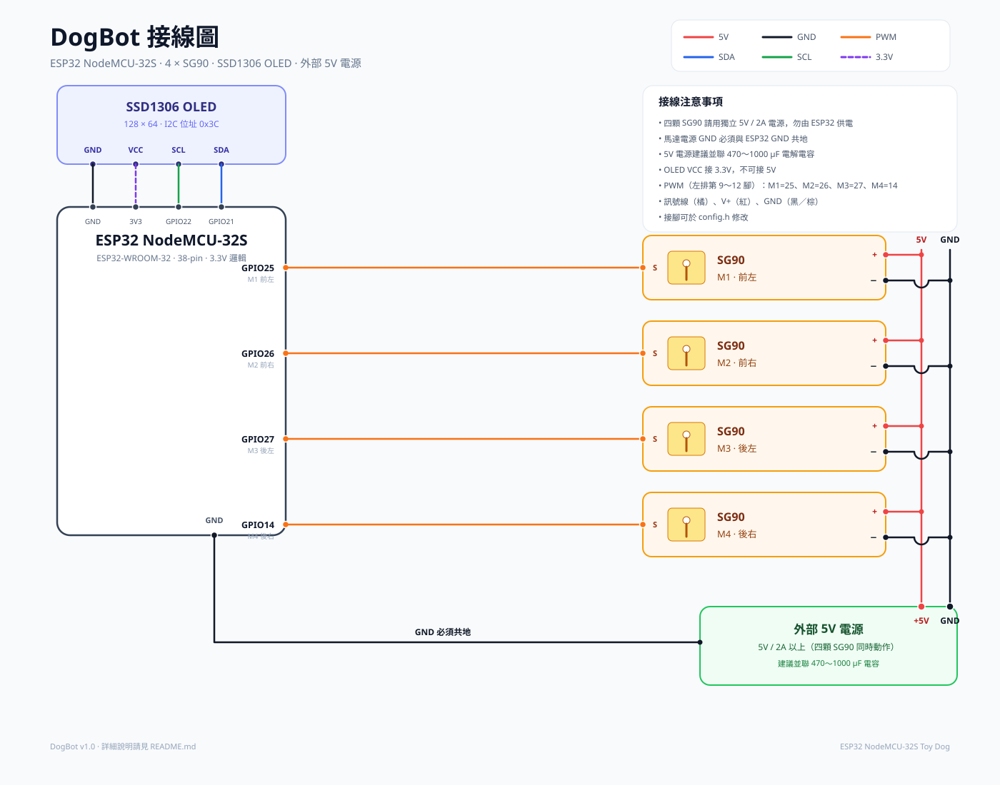

# DogBot — ESP32 NodeMCU-32S 玩具狗

> 目前版本：**v1.2.0**（2026-11-12）
>
> 本專案由 [`esp32-D1-mini_dog`](../esp32-D1-mini_dog) 移植，開發板改為
> **ESP32 NodeMCU-32S（ESP32-WROOM-32 / 30-pin）**，並依 NodeMCU-32S
> 腳位重新定義、加入編譯期腳位檢查。

以 **ESP32 NodeMCU-32S** 製作的四足玩具狗，使用 4 顆 **SG90** 伺服馬達驅動四條腿，
搭配 **SSD1306 OLED** 顯示隨機表情，並以 **SPIFFS + Web Server** 提供完整的中文控制台。

- 開發環境：**Arduino IDE 1.8.19** + ESP32 core 2.x
- 前端：純 HTML / CSS / JavaScript（無外部 CDN，離線可用）
- 後端：ESP32 WebServer + SPIFFS + OTA

---

## 功能

### 前端控制台（Sidebar 五大區塊）

| 區塊 | 功能 |
| --- | --- |
| **系統狀態** | WiFi SSID / IP / RSSI / MAC、開發板名稱、韌體版本、運作時間、可用記憶體、SPIFFS 容量與檔案目錄 |
| **WiFi 設定** | 掃描附近 SSID（顯示訊號強度）、點選帶入、手動輸入 SSID / 密碼、清除連線設定 |
| **動作控制** | 虛擬搖桿（前進 / 後退 / 左轉 / 右轉，支援觸控與鍵盤方向鍵）、特殊指令：坐下、趴下、舉手、撒嬌 |
| **SG90 測試** | 4 個滑桿即時調整 4 顆馬達角度（0°～180°）、全部置中、同步角度、微調／反轉校正（自動儲存） |
| **OTA 更新** | 韌體 `.bin` 與 SPIFFS 前端映像 `spiffs.bin` 上傳、即時進度條、更新後自動重新啟動 |

### 裝置端

- **SSD1306 128×64 OLED**：隨機表情（開心、眨眼、睡覺、愛心、生氣、頭暈、興奮、走路），
  並顯示目前 IP／AP 位址。
- **四足步態引擎**：對角步態、非阻塞更新、角度限速平滑移動。
- **特殊姿勢**：坐下、趴下、舉手（3 秒）、撒嬌（4 秒）。
- **WiFi STA + AP 共存**：AP 熱點常駐（`DogBot-<MAC 後 4 碼>`），連上家用 WiFi 後
  仍可透過熱點進入控制台；STA 斷線會自動重試。
- **OTA**：可從網頁更新韌體或 SPIFFS 前端映像，不需要插 USB。

---

## 專案結構

```
esp32_nodemcu_32s_dog/            # Arduino sketch
├─ esp32_nodemcu_32s_dog.ino      # 主程式：WiFi、Web Server、API、OTA
├─ config.h                       # NodeMCU-32S 腳位、WiFi、OLED、伺服馬達設定
├─ dog_servo.h / .cpp             # 四足步態與姿勢控制
├─ dog_face.h / .cpp              # OLED 隨機表情
└─ data/                          # 上傳到 SPIFFS 的前端檔案
   ├─ index.html
   ├─ style.css
   └─ app.js

docs/
├─ NodeMcu-32S_接腳圖-1.png       # 36 GPIO DevKit 腳位圖
├─ NodeMcu-32S_接腳圖-2.png       # 30-pin NodeMCU-32S 腳位圖（本專案採用）
├─ NodeMcu-32S_接腳說明.pdf
├─ PINMAP.md                      # 本專案腳位對照與保留腳位說明
└─ wiring.svg                     # 接線圖

tools/                            # 輔助工具
├─ build_spiffs.ps1               # 建立 SPIFFS 映像（PowerShell）
└─ build_spiffs.bat               # Windows 批次檔包裝
```

> Arduino IDE 會以資料夾名稱尋找主程式，請直接開啟
> `esp32_nodemcu_32s_dog/esp32_nodemcu_32s_dog.ino`。

---

## 硬體需求

| 零件 | 數量 | 備註 |
| --- | --- | --- |
| ESP32 NodeMCU-32S | 1 | ESP32-WROOM-32，30-pin 或 38-pin 皆可（腳位編號相同） |
| SG90 伺服馬達 | 4 | 分別對應四條腿 |
| SSD1306 OLED | 1 | 128×64，I2C，位址 0x3C（或 0x3D） |
| 外部 5V 電源 | 1 | **建議 5V / 2A 以上**，不可只靠 USB 供電 |
| 電容 | 1 | 470～1000 µF，跨接在伺服馬達電源上 |

### 接線表（NodeMCU-32S）



| 訊號 | GPIO | NodeMCU-32S 位置 | 說明 |
| --- | --- | --- | --- |
| SG90 M1 訊號（前左） | **25** | 左排第 8 腳 | 橘色 / 訊號線 |
| SG90 M2 訊號（前右） | **26** | 左排第 9 腳 | 橘色 / 訊號線 |
| SG90 M3 訊號（後左） | **27** | 左排第 10 腳 | 橘色 / 訊號線 |
| SG90 M4 訊號（後右） | **14** | 左排第 11 腳 | 橘色 / 訊號線 |
| OLED SDA | **21** | 右排第 5 腳（SDA） | I2C 資料 |
| OLED SCL | **22** | 右排第 2 腳（SCL） | I2C 時鐘 |
| OLED VCC | 3V3 | 右排第 15 腳 | **不要接 5V** |
| OLED GND | GND | 左排第 14 腳或右排第 14 腳 | |
| 伺服馬達 V+ | 外部 5V | — | 4 顆馬達並聯 |
| 伺服馬達 GND | 外部 5V GND | — | **必須與 ESP32 GND 共地** |
| 板載 LED | 2 | 右排第 12 腳 | 藍色 LED，低電位點亮 |

> 腳位計數方式：左排由 **EN = 第 1 腳**往下數（EN、36、39、34、35、32、33、**25、26、27、14**、12、13、GND、VIN）；
> 右排由 **GPIO23 = 第 1 腳**往下數（23、**22**、TX0、RX0、**21**、19、18、5、17、16、4、**2**、15、GND、3V3）。

> ⚠️ SG90 啟動瞬間電流可達 1A 以上。四顆同時動作請務必使用獨立 5V 電源，
> 並將電源 GND 與 ESP32 GND 相接，否則可能造成 ESP32 重啟或網頁斷線。

### NodeMCU-32S 腳位選用原則

| 腳位 | 狀態 | 本專案用途 |
| --- | --- | --- |
| GPIO25 / 26 / 27 / 14 | PWM 輸出，非 strapping | 四顆 SG90（左排相鄰，方便接線） |
| GPIO21 / 22 | I2C（SDA / SCL） | SSD1306 OLED |
| GPIO2 | 板載藍色 LED（低電位點亮） | 狀態燈 |
| GPIO34 / 35 / 36 / 39 | **僅能輸入** | 不可接伺服馬達訊號 |
| GPIO0 / 5 / 12 / 15 | strapping 腳 | 避免當輸出使用 |
| GPIO1 / 3 | UART0（序列埠） | 保留給序列監控 |
| GPIO6～11 | 內部 SPI Flash | 不可使用 |
| GPIO4 / 16 / 17 / 18 / 19 / 23 / 32 / 33 | 可用 | 預留擴充 |

完整腳位對照請見 [`docs/PINMAP.md`](docs/PINMAP.md)。`config.h` 會用 `static_assert`
與 `#error` 檢查重複腳位及 GPIO34～39 誤用，接錯會在編譯時就失敗。

---

## 開發環境安裝

### 1. Arduino IDE

安裝 **Arduino IDE 1.8.19**（本專案以此版本驗證）。

### 2. ESP32 開發板支援

檔案 → 偏好設定 → 額外開發板管理員網址：

```
https://raw.githubusercontent.com/espressif/arduino-esp32/gh-pages/package_esp32_index.json
```

開發板管理員搜尋 `esp32`，安裝 **ESP32 by Espressif Systems 2.0.17**。

> 本專案同時相容 ESP32 core 2.x 與 3.x（已使用 3.3.12 編譯驗證）。
> Arduino IDE 1.8.19 建議搭配 2.0.17。

### 3. 函式庫

使用函式庫管理員（Sketch → Include Library → Manage Libraries）安裝：

| 函式庫 | 作者 | 建議版本 |
| --- | --- | --- |
| **Adafruit SSD1306** | Adafruit | 2.5.7 以上 |
| **Adafruit GFX Library** | Adafruit | 1.11.9 以上 |
| **Adafruit BusIO** | Adafruit | 會自動安裝 |

伺服馬達直接使用 ESP32 內建 **LEDC** 產生 50 Hz PWM，不需要額外的 Servo 函式庫；
API 也使用表單編碼與手動 JSON 輸出，不需要 ArduinoJson。

### 4. 開發板設定

| 選項 | 建議值 |
| --- | --- |
| Board | **NodeMCU-32S**（或 **ESP32 Dev Module**） |
| Upload Speed | 921600（不穩時改 115200） |
| CPU Frequency | 240 MHz |
| Flash Size | 4MB (32Mb) |
| Partition Scheme | **Minimal SPIFFS (1.9MB APP with OTA)** |
| Port | 對應的 COM 埠 |

> 若開發板選單沒有 `NodeMCU-32S`，選擇 `ESP32 Dev Module` 即可，兩者腳位定義相同。
> OTA 需要具備 OTA 分割區的配置；請勿選用沒有 OTA 的 `Huge APP` 方案。
> 編譯後韌體約 1.1 MB、前端檔案約 55 KB，`Minimal SPIFFS` 方案已足夠。

---

## 上傳步驟

### 1. 安裝 ESP32 Sketch Data Upload 外掛

1. 下載：<https://github.com/me-no-dev/arduino-esp32fs-plugin/releases>
2. 解壓縮後將 `ESP32FS` 資料夾放到：
   ```
   C:\Users\<你的使用者>\Documents\Arduino\tools\ESP32FS\
   ```
   完成後檔案結構應為：
   ```
   Arduino\tools\ESP32FS\tool\esp32fs.jar
   ```
3. 重新啟動 Arduino IDE，Tools 選單會出現 **ESP32 Sketch Data Upload**。

### 2. 上傳前端到 SPIFFS

1. 開啟 `esp32_nodemcu_32s_dog.ino`
2. 選擇正確的開發板與序列埠
3. **Tools → ESP32 Sketch Data Upload**
4. 等待 `SPIFFS Image Uploaded` 訊息

### 3. 上傳主程式

1. 按 **Verify** 確認編譯成功
2. 按 **Upload** 上傳

---

## 第一次使用

1. 開啟序列埠監控（115200）。開機會顯示：
   ```
   ===== DogBot / ESP32 NodeMCU-32S =====
   [BOARD] ESP32 NodeMCU-32S
   ```
2. 裝置開機後會**同時**開啟 AP 熱點與嘗試連線家用 WiFi：
   - SSID：`DogBot-XXXX`（XXXX 為 **MAC 後 4 碼**十六進位，例如 `DogBot-1A2B`）
   - 密碼：`12345678`
   - 網址：<http://192.168.4.1>
3. 用手機或電腦連線到該 AP，開啟網頁。
4. 進入 **WiFi 設定**：
   - 按「掃描網路」→ 點選家中 SSID → 輸入密碼 → 儲存並連線
   - 或直接手動輸入 SSID / 密碼
5. 裝置重新啟動後會連上家用 WiFi，**AP 熱點仍會保持開啟**。之後可用：
   - `http://<裝置 STA IP>/`（與裝置同一個區網）
   - `http://192.168.4.1/`（連著 DogBot 熱點時）
   - `http://dogbot.local/`（mDNS，Windows 需支援 Bonjour）

> 狀態頁的 WiFi 卡片會同時顯示 STA 與 AP 資訊；即使已連上家用網路，
> 仍可連線 `DogBot-XXXX` 熱點直接進入控制台。

### 介面操作

- **動作控制**：拖曳圓形搖桿控制方向與速度，放開即停止；桌面可用方向鍵。
- **特殊指令**：坐下／趴下會維持姿勢；舉手／撒嬌數秒後自動回待機。
- **SG90 測試**：拖曳滑桿會進入「手動測試」模式並暫停步態；
  按「回到待機」或任一特殊指令即可恢復。
- **系統狀態**：每 5 秒自動更新，也可手動重新整理。

---

## OTA 無線更新

網頁 **OTA 更新** 頁面上方可切換兩種更新目標：

| 目標 | 用途 | 檔案 |
| --- | --- | --- |
| **韌體 .bin** | 更新主程式 | `esp32_nodemcu_32s_dog.ino.bin` |
| **SPIFFS .bin** | 更新網頁前端 | `build/spiffs.bin` |

### 更新韌體

1. Arduino IDE：**草稿碼 → 匯出已編譯二進位檔**
2. 在專案目錄的 `build/` 下找到 `esp32_nodemcu_32s_dog.ino.bin`
3. 網頁進入 **OTA 更新**，選擇「韌體 .bin」，拖曳檔案後按「開始更新」
4. 更新完成後裝置自動重新啟動

### 更新 SPIFFS 前端

先用工具建立 SPIFFS 映像（Windows）：

```bat
tools\build_spiffs.bat
```

或直接使用 PowerShell：

```powershell
.\tools\build_spiffs.ps1
```

預設輸出 `build/spiffs.bin`，大小 128 KB（`0x20000`），對應
**Minimal SPIFFS (1.9MB APP with OTA)**。若使用其他分割配置，請以 `-Size` 指定：

```powershell
.\tools\build_spiffs.ps1 -Size 0x100000 -Out build\big_spiffs.bin
```

等價的手動指令：

```bat
"%LOCALAPPDATA%\Arduino15\packages\esp32\tools\mkspiffs\0.2.3\mkspiffs.exe" -c esp32_nodemcu_32s_dog\data -b 4096 -p 256 -s 0x20000 build\spiffs.bin
```

接著在網頁選擇「SPIFFS .bin」，上傳 `build/spiffs.bin`。
更新完成後裝置會重新啟動；若瀏覽器仍顯示舊畫面，請強制重新整理（Ctrl+F5）。

### 注意事項

- 更新期間請勿斷電。
- 若更新失敗，重新上電後仍可透過 USB 重新燒錄。
- SPIFFS 映像不可大於分割區大小，否則更新會失敗。

---

## API 一覽

所有 POST 皆使用 `application/x-www-form-urlencoded`。

| Method | 路徑 | 參數 | 說明 |
| --- | --- | --- | --- |
| GET | `/api/status` | — | WiFi、系統、開發板、SPIFFS、伺服馬達狀態 |
| GET | `/api/wifi/scan` | — | 掃描 WiFi，回傳 SSID / RSSI / 加密 |
| POST | `/api/wifi` | `ssid`, `pass` | 儲存 WiFi 並重新啟動 |
| POST | `/api/wifi/clear` | — | 清除 WiFi 設定並重新啟動（AP 模式） |
| POST | `/api/move` | `x`, `y`（-1～1） | `y` 前後、`x` 左右轉 |
| POST | `/api/action` | `action` | `sit` / `lie` / `wave` / `wag` / `stand` / `stop` |
| POST | `/api/servo` | `ch`（0～3）, `angle`（0～180） | 手動設定單顆馬達 |
| POST | `/api/servo` | 無 | 取得目前角度 |
| POST | `/api/servo/center` | — | 四顆馬達回到 90° |
| POST | `/api/servo/calib` | `ch`, `trim`（-45～45）, `rev`（0/1） | 設定單顆馬達微調／反轉並存檔 |
| POST | `/api/servo/calib/reset` | — | 四顆校正全部歸零 |
| POST | `/api/reboot` | — | 重新啟動 |
| POST | `/api/ota` | multipart 檔案 | OTA 韌體更新 |
| POST | `/api/ota/fs` | multipart 檔案 | OTA SPIFFS 映像更新 |

`/api/status` 會多回傳一個 `board` 欄位，例如：

```json
{"ok":true,"fw":"1.2.0","name":"DogBot","board":"ESP32 NodeMCU-32S","wifi":{...}}
```

範例：

```bash
curl -X POST http://192.168.4.1/api/move -d "x=0&y=0.8"
curl -X POST http://192.168.4.1/api/action -d "action=wag"
curl -X POST http://192.168.4.1/api/servo -d "ch=1&angle=135"
```

---

## 校正與調整

### 網頁校正（建議）

進入 **SG90 測試**，每顆馬達下方都有：

- **微調**：`-30°～+30°`，修正馬達中立點與連桿誤差。
- **反轉**：左右腳安裝方向相反時勾選（以 90° 為中心鏡像）。
- **校正歸零**：一次清除四顆馬達的微調與反轉。

設定會即時套用並自動寫入 SPIFFS `/servo.cfg`，重新開機仍會保留。
實際輸出角度公式：

```
實際角度 = 90 + (邏輯角度 - 90) × (反轉 ? -1 : 1) + 微調
```

### 伺服馬達腳位／脈寬（NodeMCU-32S）

編輯 `config.h`：

```cpp
#define SERVO_PIN_FL 25   // 左排第 8 腳
#define SERVO_PIN_FR 26   // 左排第 9 腳
#define SERVO_PIN_RL 27   // 左排第 10 腳
#define SERVO_PIN_RR 14   // 左排第 11 腳
#define SERVO_MIN_US 500
#define SERVO_MAX_US 2400
```

若馬達會撞到機構邊界，先縮小 `SERVO_MIN_US` / `SERVO_MAX_US` 範圍，
再調整 `dog_servo.cpp` 內的角度。

> 想換腳位時，請選用可輸出的 GPIO（例如 32、33、4、16、17、18、19、23），
> **不要使用 34～39**（僅輸入）或 6～11（內部 Flash）。

### 姿勢角度

`dog_servo.cpp` 上方：

```cpp
const float POSE_STAND[4] = {90, 90, 90, 90};
const float POSE_SIT[4]   = {112, 112, 68, 68};
const float POSE_LIE[4]   = {136, 136, 44, 44};
```

陣列順序為 **前左、前右、後左、後右**。可依實際機構修改。
步態振幅與速度在 `MODE_WALK` 區塊（`swing`、`freq`）調整。

### OLED

- 預設位址 `0x3C`，若顯示空白會自動嘗試 `0x3D`。
- NodeMCU-32S 接腳：SDA = GPIO21、SCL = GPIO22，設定在 `config.h`。
- 若 OLED 初始化失敗，序列埠會顯示 `[OLED] SSD1306 not found`，網頁其餘功能不受影響。

### WiFi / AP

- **STA + AP 共存**：AP 熱點一律開啟，STA 可同時連線家用網路
- AP SSID：`AP_SSID_PREFIX` 加上 MAC 後 4 碼（`config.h`）
- AP 密碼：`AP_PASSWORD`（預設 `12345678`）
- STA 斷線重試間隔：`WIFI_RETRY_MS`（預設 15 秒）
- 熱點 IP 固定為 `192.168.4.1`
- WiFi 設定儲存在 SPIFFS `/wifi.txt`（純文字，密碼未加密，僅適合家用區網）
- 伺服馬達校正儲存在 SPIFFS `/servo.cfg`

```cpp
#define AP_SSID_PREFIX "DogBot-"   // 實際 SSID 例如 DogBot-1A2B
#define AP_PASSWORD    "12345678"
#define WIFI_RETRY_MS  15000
```

> AP 常駐會讓裝置持續廣播；若在意耗電，可在 `maintainNetwork()` 自行調整關閉時機。

---

## 與 D1 mini 版本的差異

| 項目 | ESP32 D1 mini 版 | 本專案（NodeMCU-32S） |
| --- | --- | --- |
| Sketch 資料夾 | `esp32_d1_mini_dog` | `esp32_nodemcu_32s_dog` |
| 開發板設定 | LOLIN D32 / ESP32 Dev Module | **NodeMCU-32S** / ESP32 Dev Module |
| 伺服馬達腳位 | GPIO25 / 26 / 27 / 14 | **相同**（NodeMCU-32S 左排第 8～11 腳） |
| OLED I2C | GPIO21 / 22 | **相同**（NodeMCU-32S 預設 SDA / SCL） |
| 腳位檢查 | 無 | **編譯期 `static_assert` / `#error`** |
| 狀態 API | `board` 欄位無 | 新增 `board`，網頁顯示開發板名稱 |

> NodeMCU-32S 與 D1 mini 都是 ESP32-WROOM-32，GPIO 編號相同；
> 這次移植重點在於**依 NodeMCU-32S 實際排針位置重新確認腳位**、
> 標示僅輸入／strapping 腳位，並用編譯期檢查避免誤接。

---

## 常見問題

**Q：網頁顯示「找不到前端檔案」**
A：SPIFFS 沒有上傳成功。請確認 `data/` 內有 `index.html`、`style.css`、`app.js`，
並執行 **Tools → ESP32 Sketch Data Upload**。

**Q：Tools 選單沒有 ESP32 Sketch Data Upload**
A：外掛路徑必須是 `Arduino\tools\ESP32FS\tool\esp32fs.jar`，放好後完全關閉並重開 Arduino IDE。

**Q：OLED 沒畫面**
A：確認 VCC 接 3.3V、SDA = GPIO21、SCL = GPIO22、GND 共地；
NodeMCU-32S 的 I2C 腳位在右排（22 在上、21 在下），必要時用 I2C 掃描確認位址。

**Q：編譯出現「伺服馬達不可使用 GPIO34~39」**
A：`config.h` 的腳位檢查偵測到僅輸入腳位。請改用 GPIO25 / 26 / 27 / 14
或其他可輸出腳位（32、33、4、16、17、18、19、23）。

**Q：伺服馬達抖動或 ESP32 一直重啟**
A：幾乎都是供電問題。請用獨立 5V/2A 電源、共地，並加 470µF 以上電容；
USB 供電不足以驅動四顆 SG90。NodeMCU-32S 的 VIN 不可作為馬達電源。

**Q：WiFi 掃描不到網路**
A：AP 模式下掃描會暫停 AP 廣播數秒，請稍候再試；亦可直接手動輸入 SSID。
掃描時請靠近路由器。

**Q：OTA 更新失敗**
A：確認 Partition Scheme 含 OTA、上傳的是 `.bin` 而非 `.elf`，且更新期間未斷電。
更新 SPIFFS 時請確認 `spiffs.bin` 不超過分割區大小。必要時以 USB 重新燒錄。

**Q：更新 SPIFFS 後網頁沒變**
A：確認上傳的是 `build\spiffs.bin`、大小正確，並在更新後強制重新整理（Ctrl+F5）清除瀏覽器快取。

**Q：`dogbot.local` 連不上**
A：Windows 需安裝 Bonjour；也可直接使用狀態頁顯示的 IP。

---

## 授權

本專案為教學與個人玩具用途，可自由修改使用。
